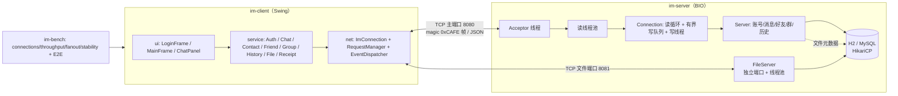

# IM 即时通讯系统

基于 **Java 17 + 原生 Socket + Swing** 的 C/S 即时通讯系统：自定义二进制协议、BIO 多线程服务端、
可靠投递（幂等入库 + 收件箱 + 投递确认）、好友/群聊/离线消息/文件传输、可复现的压测与优化记录。

> 定位：可运行、可演示、每个设计都能在面试中讲清楚的简历项目。详细设计见 [docs/DESIGN.md](docs/DESIGN.md)，
> 协议规范见 [docs/protocol.md](docs/protocol.md)，压测数据见 [docs/benchmark.md](docs/benchmark.md)。

## 功能清单

| 功能 | 客户端 | 服务端 | 说明 |
|---|---|---|---|
| 注册 / 登录 / 登出 | ✅ | ✅ | PBKDF2 加盐哈希；登录发 token |
| token 重登 / 踢旧连接 | ✅ | ✅ | 同账号再登发 `KICK_NOTIFY`，旧端回登录页 |
| 好友 | ✅ | ✅ | 事务双向写入；在线优先排序、离线置灰 |
| 私聊 | ✅ | ✅ | `msgId` 幂等、`MSG_ACK`、`DELIVER_ACK` |
| 群聊 | ✅ | ✅ | 建群事务拉创建者入群；扇出除发送者；群成员面板 |
| 离线消息 | ✅ | ✅ | 收件箱表；登录/重登后 100 条/批，确认一批推下一批 |
| 历史消息 | ✅ | ✅ | 会话分页，默认 50、上限 100、`beforeId` 游标 |
| 文件传输 | ✅ | ✅ | 独立端口 + 独立线程池；上传/下载进度、取消、MD5 校验 |
| 心跳与重连 | ✅ | ✅ | 客户端 30s PING；指数退避重连 + token 自动重登 |
| 在线用户 / 未读数 / 托盘通知 | ✅ | ✅ | 圆点状态、未读徽标、系统托盘通知 |
| 压测与 E2E | — | — | `im-bench` 四场景 + 全链路 E2E 测试 |

## 架构图



## 快速启动

### 方式一：H2 零配置（推荐，默认）

```bash
mvn -q clean verify
java -jar im-server/target/im-server.jar --port 8080 --file-port 8081
```

默认使用 H2 文件库 `./data/im`（MySQL 兼容模式），无需安装数据库；建表脚本随 jar 自动执行。

### 方式二：docker-compose 启动 MySQL 8

```bash
# 1. 启动 MySQL（root/root，库 im，用户 im/im123456）
docker compose up -d

# 2. 用 MySQL 启动服务端（首次启动自动建表）
java -jar im-server/target/im-server.jar --port 8080 --file-port 8081 \
  --db "jdbc:mysql://127.0.0.1:3306/im?useSSL=false&serverTimezone=UTC&characterEncoding=utf8" \
  --db-user im --db-password im123456
```

服务端按 JDBC URL 自动选择 `schema.sql`（H2）或 `schema-mysql.sql`（MySQL）。

### 客户端

```bash
java -jar im-client/target/im-client.jar --host 127.0.0.1 --port 8080 --file-port 8081
```

同一台机器可多开，用于演示。

## 演示步骤（1 个服务端 + 3 个客户端）

1. 启动服务端（方式一或方式二）。
2. 开三个终端分别启动客户端，登录页点「注册新账号」创建 `alice`、`bob`、`carol`，再登录。
3. **好友**：alice 在「好友」页「添加好友」bob、carol；在线好友排前，关闭 carol 客户端后刷新变灰。
4. **私聊**：alice 双击 bob 发消息——右侧气泡、状态「发送中→已发送」；bob 收到并滚到底部，未打开会话时有未读徽标与托盘通知。
5. **群聊**：alice「群聊」页「建群」拿到群号；bob、carol「加群」；alice 双击群，右侧显示成员与在线状态；发群消息，成员收到且显示发送者昵称。
6. **离线**：关闭 bob 客户端，alice 连发 3 条；bob 重新登录后按序收到并计入未读。
7. **文件**：alice 在私聊面板「发送文件」→ 进度条；bob 点文件气泡「下载」→ 校验 MD5 → 可打开所在文件夹。
8. **重连**：停掉服务端 → 状态栏「重连中（第 N 次）」；期间发消息显示失败可重发；重启服务端自动重登并补收离线。
9. **顶号**：同一账号再登录一次，旧客户端弹窗后回到登录页。

## 截图

| 登录 | 主窗口 / 私聊 | 群聊 |
|---|---|---|
|  |  |  |

> 截图占位：首次运行后可将实际界面截图放入 `docs/screenshots/`（login.png / chat.png / group.png）。

## 模块结构

```
im-parent/         聚合 POM，统一版本
├── im-common/     协议契约：帧编解码、MessageType、各域 DTO、ErrorCode
├── im-server/     BIO 服务端：db/repo/service、FileServer、DemoClient
├── im-client/     net / service / ui 三层 + FlatLaf 界面
└── im-bench/      压测四场景 + 端到端测试
```

## 质量数据

| 项 | 数据 |
|---|---|
| 测试 | `mvn clean verify`：**50** 个测试（协议 15、服务端 21、客户端 13、E2E 1） |
| 私聊吞吐 | 40 对×20/s：**582 msg/s**，P50 1ms / P95 3ms / P99 8ms |
| 优化收益 | 单事务写库：吞吐 65→**83 msg/s（+27.7%）**；50 人群扇出 19.7→**16.0ms（-18.8%）** |
| 连接 | 200 连接 100% 成功；稳定性 50 连接/20s/随机断 5%：重连 36 次 0 失败 |

## 文档

- [协议规范](docs/protocol.md) · [系统设计](docs/DESIGN.md) · [面试材料](docs/interview.md) · [压测报告](docs/benchmark.md) · [开发进度](docs/PROGRESS.md)
