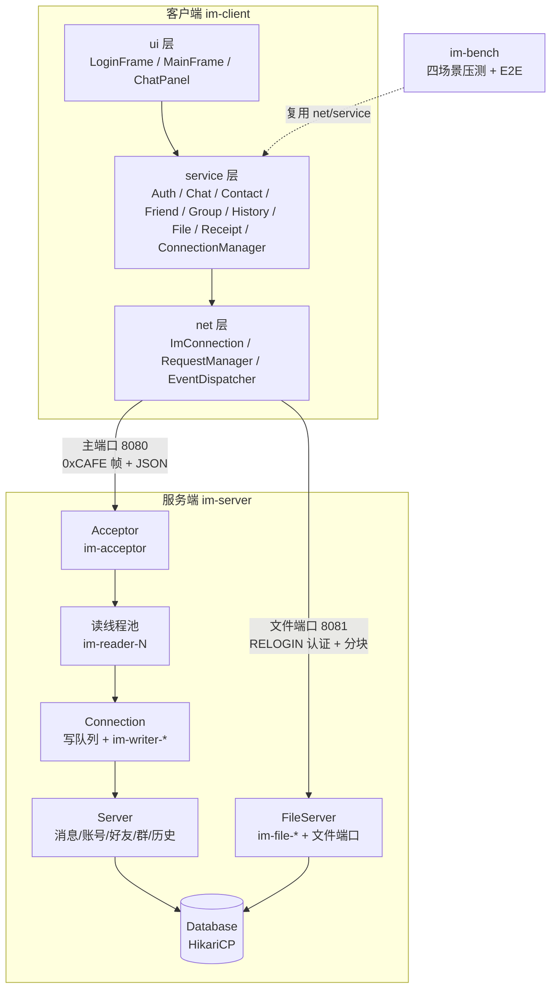
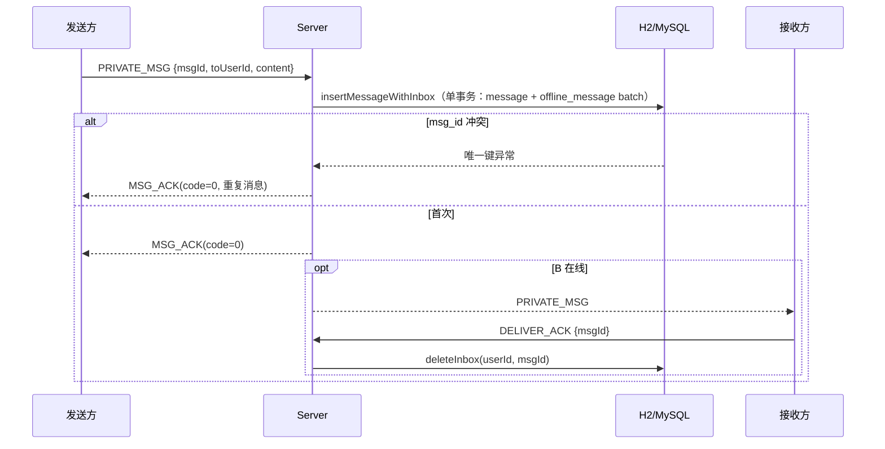

# 系统设计（DESIGN）

> 本文档描述**已实现**的系统。所有类名、方法名、配置项均可在仓库中找到；未实现的内容放在「可扩展方向」。
> 配套：协议 [protocol.md](protocol.md) · 压测 [benchmark.md](benchmark.md) · 面试 [interview.md](interview.md)

---

## 1. 系统架构



**一句话**：客户端是一个"网络线程 + EDT"的双线程世界；服务端是"1 Acceptor + N 读线程 + 每连接 1 写线程"的 BIO 模型；两者只通过 `im-common` 的帧协议通信。

---

## 2. 模块与包结构

| 模块 | 包 | 职责 |
|---|---|---|
| `im-common` | `com.im.common` | `MessageType`(38 种)、`Packet`、`ErrorCode`(17 个)、`ProtocolException` |
| | `.codec` | `PacketCodec`：帧读写、长度上限、半包/粘包处理 |
| | `.json` | `JsonUtil`：序列化与 `requestId` 提取 |
| | `.message` | 六组 DTO：`AccountMessages`、`ChatMessages`、`ContactMessages`、`GroupMessages`、`FileMessages`、`SystemMessages` |
| `im-server` | `.db` | `Database`：HikariCP 池 + 按 URL 选择 `schema.sql` / `schema-mysql.sql` |
| | `.repo` | `UserRepo`、`MessageRepo`、`SocialRepo`、`FileRepo`（JDBC + PreparedStatement） |
| | `.`（根包） | `ServerRuntime`（端口/线程池生命周期）、`Server`（业务分发）、`Connection`、`ConnectionHandler`、`ServerConfig`、`PasswordHasher`、`FileServer`、`ServerMain` |
| | `.file` | `FileDto`：文件端口负载结构 |
| | `.demo` | `DemoClient`：服务端阶段联调用的 CLI |
| `im-client` | `.net` | `ImConnection`、`RequestManager`、`EventDispatcher` |
| | `.service` | `AuthService`、`ChatService`、`ContactService`、`FriendService`、`GroupService`、`HistoryService`、`FileService`、`ReceiptService`、`ConnectionManager`、`ImService`（bench 同步门面） |
| | `.file` | `FileDtos`、`FileMessage`（聊天里的文件引用约定） |
| | `.ui` | `Theme`、`UiThread`、`LoginFrame`、`RegisterDialog`、`MainFrame`、`ChatPanel`、`ProgressDialog`、`TrayNotifier` |
| `im-bench` | `.bench` | `BenchMain`（四场景）、`E2eTest`（全链路） |

---

## 3. 简历要点 ↔ 代码实现

| 简历原文 | 代码落点 |
|---|---|
| 「使用 Swing 构建登录窗口、好友列表、聊天窗口，布局与事件监听」 | `ui/LoginFrame`（表单校验/记住用户名/登录中禁用）、`ui/MainFrame`（四标签页 + CardLayout + 状态栏）、`ui/ChatPanel`（气泡/Enter 发送/Shift+Enter 换行/自动滚底）、`ui/Theme`（FlatLaf + 中文字体回退） |
| 「基于 TCP 实现长连接；自定义应用层协议传输消息」 | `codec/PacketCodec`（`0xCAFE` + version + type + length≤1MiB + JSON，`readFully` 处理半包粘包）、`ImConnection`（读/写线程 + 心跳 + 状态机）、`docs/protocol.md` |
| 「服务端为每个连接分配独立线程处理；客户端独立线程监听，避免阻塞 UI」 | 服务端：`ServerRuntime`（Acceptor + 读线程池）+ `Connection`（每会话有界写队列 + 写线程）; 客户端：`ImConnection` 的 `im-net-reader`/`im-net-writer`，UI 更新一律 `UiThread.run`（EDT） |
| 「注册登录、群聊/私聊实时推送、在线用户、离线消息存储」 | `Server.onRegister/onLogin`、`onPrivateMsg`、`onGroupMsg`、`onOfflinePush`（`pushOffline` 批量 100）、`ContactService`/`FriendService`、`MessageRepo.insertMessageWithInbox/listInbox/deleteInbox` |

---

## 4. 协议一览

完整字段见 [protocol.md](protocol.md)。要点：

- 帧：`magic(2B=0xCAFE) | version(1B=1) | type(1B) | length(4B) | body(UTF-8 JSON, ≤1MiB)`，大端序。
- 请求-响应：请求带 `requestId`（UUID），响应原样带回；客户端 `RequestManager` 用 `requestId→CompletableFuture` 配对，10s 超时。
- 消息类型分 7 段：账号 `0x01-0x0F`、心跳 `0x10-0x1F`、消息 `0x20-0x2F`、联系人 `0x30-0x3F`、群组 `0x40-0x4F`、文件 `0x50-0x5F`、系统 `0x60/0x7F`。
- 可靠投递四元组：`msgId`（客户端 UUID）+ `MSG_ACK`（落库确认）+ `DELIVER_ACK`（接收确认）+ `OFFLINE_MSG_PUSH`（离线补推）。

---

## 5. 数据库设计

`schema.sql`（H2）与 `schema-mysql.sql`（MySQL 8）字段一致，仅索引 DDL 语法不同。

| 表 | 字段 | 索引 | 为什么这样建 |
|---|---|---|---|
| `im_user` | id, username, salt, password_hash, created_at | UK(username) | 用户名唯一；口令存 PBKDF2 盐+哈希，不存明文 |
| `friend` | user_id, friend_id, created_at | PK(user_id, friend_id) | 双向各一行，主键天然去重；查询"我的好友"走前缀索引 |
| `chat_group` | id, name, owner_id, created_at | PK(id) | 群本体；创建者单独存成员表 |
| `group_member` | group_id, user_id, joined_at | PK(group_id, user_id) | 复合主键防重复入群；"群成员"与"我的群"都走前缀索引 |
| `message` | id, msg_id, kind, from_user, to_user, group_id, content, created_at | **UK(msg_id)**、idx(from_user,to_user)、idx(group_id) | `msg_id` 唯一是幂等根基；两个二级索引分别服务私聊/群聊历史分页 |
| `offline_message` | id, user_id, message_id, msg_id, from_user, content, created_at | **idx(user_id, id)** | 收件箱：按用户 + id 升序分批拉取，`(user_id,id)` 让"取一批、删一条"都是索引命中 |
| `file_meta` | file_id, file_name, size_bytes, md5, uploader_id, receiver_id, created_at | PK(file_id) | 文件按 fileId 落盘，原名只入库（防路径穿越）；md5 供下载校验 |

**设计取舍**：
- 收件箱**冗余存储** `msg_id/from_user/content`，读路径不 JOIN `message`，以空间换延迟；删除按 `(user_id, msg_id)`。
- 消息表不存"会话 id"，用 `(kind, from_user, to_user, group_id)` 表达，避免额外会话表；代价是私聊历史需要 OR 条件（已被 `(from_user,to_user)` 索引覆盖两侧）。
- 全部时间戳用 `BIGINT`（Unix 毫秒），避免数据库时区差异。

---

## 6. 线程模型

```mermaid
flowchart LR
    subgraph ServerThreads[服务端线程]
        A1[im-acceptor ×1<br/>accept + 上限拒绝]
        R1[im-reader-N ×(连接数)<br/>阻塞读帧 + 业务处理]
        W1[im-writer-端口 ×(连接数)<br/>有界队列串行写帧]
        F1[im-file-N ×file.threads<br/>文件端口连接]
        H1[HikariCP 连接池 ×db.pool-size]
        A1 --> R1 --> W1
        R1 --> H1
    end
    subgraph ClientThreads[客户端线程]
        C1[im-net-reader ×1/连接]
        C2[im-net-writer ×1/连接]
        C3[im-net-heartbeat 共享调度 ×1]
        C4[im-request-timeout ×1/连接]
        C5[im-chat-ack-timeout ×1/ChatService]
        C6[im-receipt-flush ×1/ReceiptService]
        C7[EDT ×1]
    end
```

| 线程 | 数量 | 职责 | 通信方式 |
|---|---|---|---|
| `im-acceptor` | 1 | `accept`，超上限回 `SERVER_BUSY` 后关闭 | 投递 `ConnectionHandler` 到读线程池 |
| `im-reader-N` | 按连接数（上限 `server.max-connections`） | 阻塞读帧 → `Server.handle` → 结果入写队列 | `LinkedBlockingQueue` 容量 `send-queue-size` |
| `im-writer-*` | 1/连接 | 串行写帧，避免多线程写同一 Socket 造成帧交错 | 队列满判定慢消费者并断开 |
| `im-file-N` | `file.threads`（默认 4） | 文件端口认证、上传/下载 | 独立端口，不占主流程线程 |
| EDT | 1 | 所有 Swing 读写 | `UiThread.run` → `SwingUtilities.invokeLater` |
| 心跳调度 | 客户端 1 个共享（压测）/1 个/连接（GUI） | 30s PING，连续 3 次无响应判死 | `ScheduledExecutorService` |

**为什么每连接两个线程**：读阻塞在 `read()`，写可能被慢客户端阻塞；分离后写慢不拖住读，且写队列容量给出背压边界（1024，超出即断开）。代价是连接数上限受线程数约束，见 §10。

---

## 7. 关键流程

### 7.1 登录

`LoginFrame` 校验 → `AuthService.login` → `LOGIN_REQ{requestId,username,password}` → `Server.onLogin`：
`UserRepo.findByUsername` + `PasswordHasher.verify`（PBKDF2）→ 生成 token → `bind()`（`online.put`，若有旧连接发 `KICK_NOTIFY` 并关闭）→ 回 `LOGIN_RESP` → `pushOffline(conn)`。

### 7.2 私聊可靠投递



### 7.3 离线消息

登录/重登成功 → `pushOffline`：`listInbox(userId, 100)` → `OFFLINE_MSG_PUSH{messages,lastId}` → `conn.setPendingAcks(n)`；
客户端 `ReceiptService` 200ms 批量回 `DELIVER_ACK`；服务端 `onDeliverAck` 删除记录，`pendingAcks<=0` 且仍有存量时推下一批。
未确认即断线 → 记录仍在库中 → 下次登录重推（至少一次，客户端按 `msgId` 去重）。

### 7.4 群聊

`GROUP_MSG` → 校验群存在 + 发送者是成员 → `membersOf` 取成员 → 收件人 = 除发送者 → `insertMessageWithInbox` 批量 → 在线成员立即推送、离线成员留在收件箱。

### 7.5 心跳与重连

客户端每 30s 发 `PING`（`ImConnection.heartbeat`），`lastInboundAt` 超过 `30s×3` 判死并触发断开；
断开后 `ConnectionManager` 指数退避（1s、2s、4s…上限 30s，最多 10 次）→ `ImConnection.reconnect()` 重建 socket（监听器/请求表保留）→ `AuthService.relogin(token)` → 成功刷新界面并补收离线，token 失效则回登录页。

> 已知缺口：服务端 `server.heartbeat-seconds` 目前只有配置项，**空闲连接扫描未实现**；空闲由客户端主动探测。

### 7.6 文件传输

`FileService.upload`：新开文件端口连接 → `RELOGIN_REQ{token}` 认证 → `FILE_UPLOAD_REQ{fileName,fileSize,md5,toUserId}` → 服务端校验大小、回 `fileId` → 客户端按 64KiB 发 `FILE_UPLOAD_CHUNK`（Base64），服务端校验 `offset` 连续、边写边算 MD5 → `eof` 时校验总长与 MD5，临时文件 rename 为 `fileId` 并写 `file_meta`。
下载：`FILE_DOWNLOAD_REQ{fileId,offset}` → 服务端校验"上传者或接收者" → 64KiB 分块回 `FILE_DOWNLOAD_RESP` → 客户端拼装、比对发送方 msg 里的 md5、落盘并可打开文件夹。
聊天消息里以 `[[FILE]]{fileId,fileName,size,md5}` 承载文件引用（客户端约定，不改协议）。

---

## 8. 设计取舍

| 选择 | 理由 | 代价 |
|---|---|---|
| 原生 Socket + BIO | 满足简历"无框架"要求，代码可读、可讲透 | 连接数受线程数限制，见 §10 |
| 二进制帧 + JSON 负载 | 帧头固定长、易解析；JSON 可读、跨语言、调试友好 | 文本体积大于 Protobuf；高频场景有序列化开销 |
| `msg_id` 唯一索引做幂等 | 数据库层保证，重发天然去重，无需分布式锁 | 每次插入可能触唯一键异常（已用异常分支处理） |
| 收件箱冗余 + `DELIVER_ACK` 删除 | 读路径简单，离线/在线统一；至少一次投递 | 在线消息也写一次收件箱，写放大（优化 1 已把 3 次提交降到 1 次） |
| 群聊写扩散 | 成员数 ≤ 百级时实现简单、读路径 O(1) | 大群写放大，需改读扩散/推拉结合 |
| 心跳应用层实现 | 可控间隔、可区分"连接活着但业务卡死" | 多一条 PING 流量 |
| 客户端 requestId→Future | 请求响应解耦，超时统一 | 需要维护 pending 表与超时清理 |

---

## 9. 可扩展方向

1. **传输层**：`ImConnection`/`Connection` 已隔离 Socket，可替换为 NIO `Selector` 或 Netty；协议不变。
2. **多机部署**：网关按 `userId` 哈希路由 + Redis 存"用户→节点"在线状态 + MQ 广播跨节点消息；`online` Map 下沉到 Redis。
3. **大群**：读扩散（成员拉取）+ 推拉结合，或分片扇出 + 异步任务。
4. **服务端空闲检测**：定时扫描 `Connection.lastActive`，超时关闭（配置项已就位）。
5. **消息顺序**：当前按 `message.id` 单调递增；多机时改用 `(session, seq)` 或雪花 ID + 客户端排序。
6. **文件**：流式读写替代整文件入内存，断点续传与秒传（md5 命中）。
7. **安全**：TLS、token 过期与刷新、敏感词/限流。
