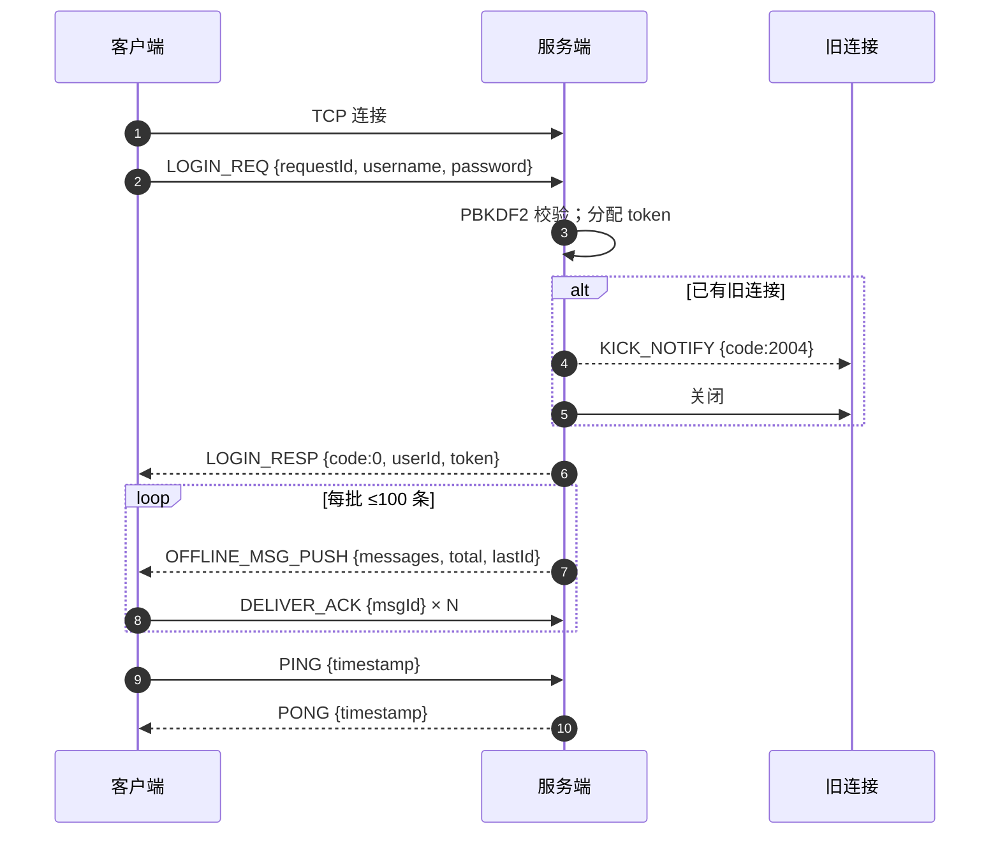
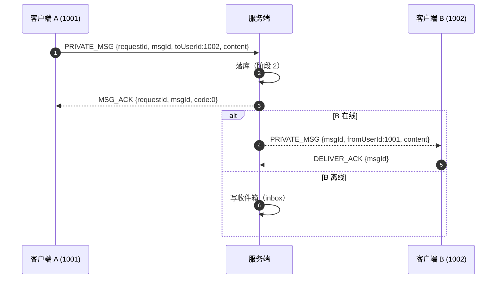
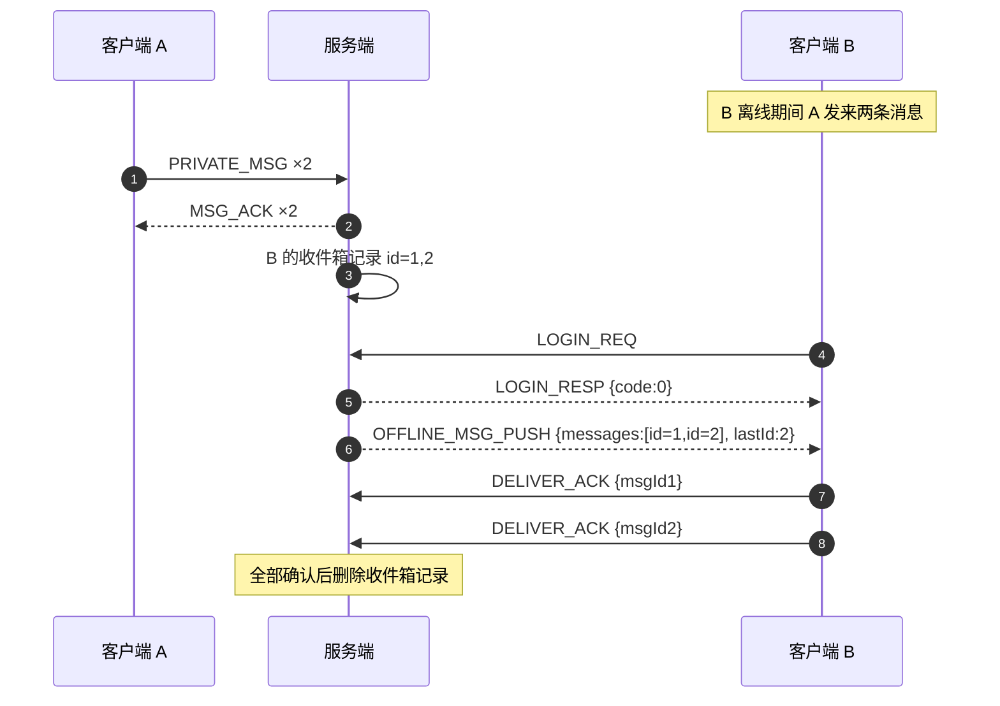
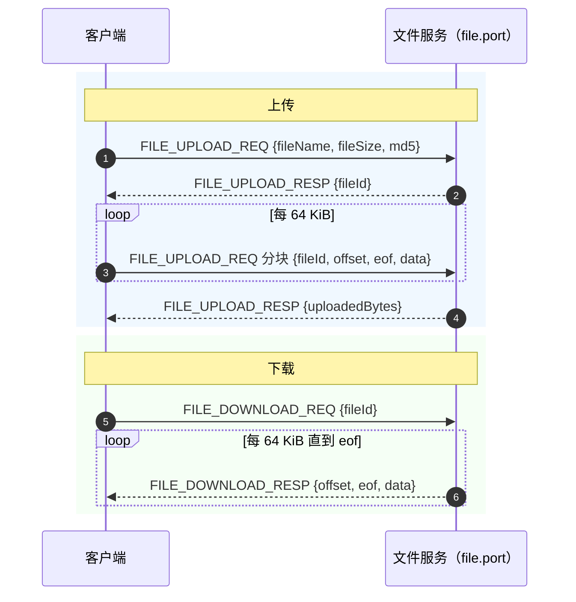

# IM 通信协议 v1

> 本文档是协议的权威说明，按此实现即可与现有服务端互通（不依赖任何源码）。
> 协议变更必须同步更新本文档，并在 `docs/PROGRESS.md` 记录原因。

- 传输层：TCP
- 主端口：`server.port`（默认 `8080`）
- 文件端口：`file.port`（默认 `8081`，仅文件消息使用）
- 字节序：**大端序（网络字节序）**
- 负载：UTF-8 JSON
- 单帧 body 上限：**1 MiB（1,048,576 字节）**
- 版本：`1`

---

## 1. 帧格式

```
 0                   1                   2                   3
 0 1 2 3 4 5 6 7 8 9 0 1 2 3 4 5 6 7 8 9 0 1 2 3 4 5 6 7 8 9 0 1
+---------+-------+-------+---------------------------------------+
| magic(2)| ver(1)| type(1)|            length (4)                 |
+---------+-------+-------+---------------------------------------+
|                    body (length 字节, UTF-8 JSON)               |
|                             ...                                 |
+-----------------------------------------------------------------+
```

| 字段 | 偏移 | 长度 | 类型 | 说明 |
|---|---|---|---|---|
| `magic` | 0 | 2 | uint16 | 固定 `0xCAFE` |
| `version` | 2 | 1 | uint8 | 固定 `1` |
| `type` | 3 | 1 | uint8 | 消息类型，见第 3 节 |
| `length` | 4 | 4 | int32 | body 字节数，`0 ≤ length ≤ 1048576` |
| `body` | 8 | `length` | bytes | UTF-8 JSON；无字段消息可为空 |

### 1.1 校验与错误处理

接收方按顺序校验，失败即**记日志并断开**（可选先回 `ERROR`）：

| 情况 | 行为 |
|---|---|
| `magic != 0xCAFE` | 断开；错误码 `1003 INVALID_FRAME` |
| `version != 1` | 断开；错误码 `1003 INVALID_FRAME` |
| `type` 未定义 | 断开；错误码 `1004 UNKNOWN_MESSAGE_TYPE` |
| `length < 0` 或 `> 1 MiB` | 断开；错误码 `3001 FRAME_TOO_LARGE` |
| body 非法 JSON / 字段类型不符 | 回 `ERROR(1005)`，连接可继续 |
| 帧中途 EOF | 视为连接损坏，断开 |

### 1.2 粘包与半包

TCP 是字节流，一次读取可能出现多帧（粘包）或不完整帧（半包）。实现要求：

1. 循环读取：先读满 **8 字节帧头**，再按 `length` 读满 body（`DataInputStream.readFully` 语义）；
2. 帧之间无分隔符，**禁止**按换行/结束符切分；
3. 帧边界处 EOF → 对端正常关闭；帧中途 EOF → 异常断开。

### 1.3 完整帧示例

`LOGIN_REQ`，body 为 `{"requestId":"r1","username":"alice","password":"123456"}`（53 字节）：

```
CA FE | 01 | 03 | 00 00 00 35
magic  ver type   length=53      { ... JSON ... }
```

---

## 2. 通用约定

1. **请求-响应配对**：请求类消息必须带 `requestId`（客户端生成，建议 UUID），响应原样带回；
   客户端据此匹配，默认超时 10 秒（`client.request-timeout-ms`）。
2. **推送类消息**（`PRIVATE_MSG` 推送、`GROUP_MSG` 推送、`OFFLINE_MSG_PUSH`、`USER_STATUS_NOTIFY`、
   `KICK_NOTIFY`、`SERVER_BUSY`、`ERROR`）没有 requestId 语义，按类型分发。
3. **未知字段必须忽略**，便于扩展；已有字段的类型与可空性不可变。
4. 时间戳统一为 Unix 毫秒（long）。
5. `fromUserId` 一律以**服务端会话身份**为准，客户端传入值不可信。
6. 未登录连接只允许 `REGISTER_REQ`、`LOGIN_REQ`、`RELOGIN_REQ`、`PING`；其他消息回 `ERROR(2001)`。

---

## 3. 消息类型一览

| 编码 | 名称 | 方向 | 负载 |
|---|---|---|---|
| `0x01` | REGISTER_REQ | C → S | RegisterRequest |
| `0x02` | REGISTER_RESP | S → C | RegisterResponse |
| `0x03` | LOGIN_REQ | C → S | LoginRequest |
| `0x04` | LOGIN_RESP | S → C | LoginResponse |
| `0x05` | RELOGIN_REQ | C → S | ReloginRequest |
| `0x06` | RELOGIN_RESP | S → C | ReloginResponse |
| `0x07` | LOGOUT_REQ | C → S | LogoutRequest |
| `0x08` | LOGOUT_RESP | S → C | LogoutResponse |
| `0x10` | PING | C → S | Ping |
| `0x11` | PONG | S → C | Pong |
| `0x20` | PRIVATE_MSG | C → S / S → C | PrivateMsg |
| `0x21` | GROUP_MSG | C → S / S → C | GroupMsg |
| `0x22` | MSG_ACK | S → C | MsgAck |
| `0x23` | DELIVER_ACK | C → S | DeliverAck |
| `0x24` | OFFLINE_MSG_PUSH | S → C | OfflineMsgPush |
| `0x25` | HISTORY_REQ | C → S | HistoryRequest |
| `0x26` | HISTORY_RESP | S → C | HistoryResponse |
| `0x30` | FRIEND_LIST_REQ | C → S | FriendListRequest |
| `0x31` | FRIEND_LIST_RESP | S → C | FriendListResponse |
| `0x32` | ADD_FRIEND_REQ | C → S | AddFriendRequest |
| `0x33` | ADD_FRIEND_RESP | S → C | AddFriendResponse |
| `0x34` | ONLINE_USERS_REQ | C → S | OnlineUsersRequest |
| `0x35` | ONLINE_USERS_RESP | S → C | OnlineUsersResponse |
| `0x36` | USER_STATUS_NOTIFY | S → C | UserStatusNotify |
| `0x40` | GROUP_CREATE_REQ | C → S | GroupCreateRequest |
| `0x41` | GROUP_CREATE_RESP | S → C | GroupCreateResponse |
| `0x42` | GROUP_JOIN_REQ | C → S | GroupJoinRequest |
| `0x43` | GROUP_JOIN_RESP | S → C | GroupJoinResponse |
| `0x44` | GROUP_LIST_REQ | C → S | GroupListRequest |
| `0x45` | GROUP_LIST_RESP | S → C | GroupListResponse |
| `0x46` | GROUP_MEMBERS_REQ | C → S | GroupMembersRequest |
| `0x47` | GROUP_MEMBERS_RESP | S → C | GroupMembersResponse |
| `0x50` | FILE_UPLOAD_REQ | C → S | FileUploadRequest |
| `0x51` | FILE_UPLOAD_RESP | S → C | FileUploadResponse |
| `0x52` | FILE_DOWNLOAD_REQ | C → S | FileDownloadRequest |
| `0x53` | FILE_DOWNLOAD_RESP | S → C | FileDownloadResponse |
| `0x60` | KICK_NOTIFY | S → C | KickNotify |
| `0x61` | SERVER_BUSY | S → C | ServerBusy |
| `0x7F` | ERROR | S → C | ErrorMessage |

> `0x50-0x53` 只在**文件端口**使用，主端口收到时应回 `ERROR(1003)`。

---

## 4. 账号

### 4.1 注册

`REGISTER_REQ`：`{"requestId":"r-1","username":"alice","password":"123456"}`

| 字段 | 类型 | 说明 |
|---|---|---|
| requestId | string | 请求标识 |
| username | string | 用户名，唯一 |
| password | string | 明文密码（服务端 PBKDF2 加盐哈希后存储） |

`REGISTER_RESP`：`{"requestId":"r-1","code":0,"message":"注册成功","userId":1001}`

| 字段 | 类型 | 说明 |
|---|---|---|
| requestId | string | 对应请求 |
| code | int | 0 成功；1001 用户名已存在 |
| message | string | 描述 |
| userId | long | 新用户 id，失败为 0 |

### 4.2 登录

`LOGIN_REQ`：`{"requestId":"r-2","username":"alice","password":"123456"}`

`LOGIN_RESP`：`{"requestId":"r-2","code":0,"message":"登录成功","userId":1001,"username":"alice","token":"8f14e45f-..."}`

| 字段 | 类型 | 说明 |
|---|---|---|
| requestId | string | 对应请求 |
| code | int | 0 成功；1002 用户名或密码错误 |
| message | string | 描述 |
| userId | long | 用户 id |
| username | string | 用户名 |
| token | string | 会话令牌，用于 `RELOGIN_REQ` |

> 同一账号重复登录会踢掉旧连接：旧连接收到 `KICK_NOTIFY` 后关闭，**不得自动重连**。

### 4.3 token 重登

`RELOGIN_REQ`：`{"requestId":"r-3","token":"8f14e45f-..."}`

`RELOGIN_RESP`：`{"requestId":"r-3","code":0,"message":"重登成功","userId":1001,"username":"alice"}`

`code=2001` 表示 token 无效/过期，客户端应回到登录界面。

### 4.4 退出

`LOGOUT_REQ`：`{"requestId":"r-4"}`
`LOGOUT_RESP`：`{"requestId":"r-4","code":0,"message":"已退出"}`

---

## 5. 心跳

`PING`：`{"requestId":"r-5","timestamp":1700000000000}`
`PONG`：`{"requestId":"r-5","timestamp":1700000000000}`

客户端用 `now - timestamp` 计算 RTT。建议每 30 秒一次（`client.heartbeat-seconds`）；
服务端 90 秒（`server.heartbeat-seconds`）无任何数据则断开。

---

## 6. 消息

### 6.1 私聊

`PRIVATE_MSG`（发送与推送同一结构）：

```json
{"requestId":"r-6","msgId":"0b1f...","fromUserId":1001,"toUserId":1002,
 "content":"在吗","timestamp":1700000000000}
```

| 字段 | 类型 | 说明 |
|---|---|---|
| requestId | string | 请求标识（推送时为空） |
| msgId | string | 客户端生成的 UUID，全局唯一，用于去重与 ACK |
| fromUserId | long | 发送者 id（服务端以会话覆盖） |
| toUserId | long | 接收者 id |
| content | string | 文本内容 |
| timestamp | long | 客户端时间戳 |

服务端处理：落库（阶段 2）→ 回 `MSG_ACK` → 接收方在线立即推送，否则写收件箱（离线）。

`MSG_ACK`：`{"requestId":"r-6","msgId":"0b1f...","code":0,"message":"已接收"}`

### 6.2 群聊

`GROUP_MSG`：

```json
{"requestId":"r-7","msgId":"7c2d...","fromUserId":1001,"groupId":5001,
 "content":"大家好","timestamp":1700000000000}
```

字段：`requestId`、`msgId`、`fromUserId`、`groupId`、`content`、`timestamp`。响应同为 `MSG_ACK`。

### 6.3 投递确认

接收方收到消息后回 `DELIVER_ACK`：`{"requestId":"r-8","msgId":"0b1f..."}`，
服务端据此删除对应收件箱记录（离线消息场景）。

### 6.4 离线消息推送

登录/重登成功后，服务端按记录 id 升序分批推送，**每批最多 100 条**，客户端确认一批后再推下一批：

```json
{"messages":[
   {"id":1,"msgId":"0b1f...","fromUserId":1001,"content":"在吗","timestamp":1700000000000}
 ],
 "total":1,
 "lastId":1}
```

| 字段 | 类型 | 说明 |
|---|---|---|
| messages | array | 本批消息 |
| total | int | 本批条数 |
| lastId | long | 本批最后一条记录 id，无更多数据为 0 |

单条字段：`id`（收件箱记录 id）、`msgId`、`fromUserId`、`content`、`timestamp`。

客户端对每条回 `DELIVER_ACK`，全部确认后服务端推送下一批。

### 6.5 历史消息

`HISTORY_REQ`：

```json
{"requestId":"r-9","peerId":1002,"peerType":1,"beforeId":0,"limit":50}
```

| 字段 | 类型 | 说明 |
|---|---|---|
| requestId | string | 请求标识 |
| peerId | long | 对方用户 id（私聊）或群 id（群聊） |
| peerType | int | 1=私聊，2=群聊 |
| beforeId | long | 游标：只取 id 小于该值的记录，首页传 0 |
| limit | int | 条数，服务端上限 100 |

`HISTORY_RESP`：

```json
{"requestId":"r-9","code":0,"message":"ok","messages":[
  {"id":88,"msgId":"...","fromUserId":1002,"content":"hi","timestamp":1700000000000}]}
```

---

## 7. 联系人

| 消息 | 请求示例 | 响应关键字段 |
|---|---|---|
| `FRIEND_LIST_REQ/RESP` | `{"requestId":"r-10"}` | `friends:[{userId,username,online}]` |
| `ADD_FRIEND_REQ/RESP` | `{"requestId":"r-11","username":"bob"}` | `friendUserId, friendUsername, code` |
| `ONLINE_USERS_REQ/RESP` | `{"requestId":"r-12"}` | `users:[{userId,username}]` |
| `USER_STATUS_NOTIFY`（推送） | — | `{userId,username,online}` |

`ADD_FRIEND` 为双向、免审批；`2003` 表示用户不存在。

---

## 8. 群组

| 消息 | 请求示例 | 响应关键字段 |
|---|---|---|
| `GROUP_CREATE_REQ/RESP` | `{"requestId":"r-13","name":"项目组"}` | `groupId, name` |
| `GROUP_JOIN_REQ/RESP` | `{"requestId":"r-14","groupId":5001}` | `groupId`；`2005` 群不存在 |
| `GROUP_LIST_REQ/RESP` | `{"requestId":"r-15"}` | `groups:[{groupId,name,memberCount}]` |
| `GROUP_MEMBERS_REQ/RESP` | `{"requestId":"r-16","groupId":5001}` | `members:[{userId,username,online}]`；`2002` 非成员 |

---

## 9. 文件传输（文件端口）

文件消息只在 `file.port` 上交换，流程：**申请 → 分块 → 完成**。

### 9.1 上传

`FILE_UPLOAD_REQ`：`{"requestId":"f-1","fileName":"report.pdf","fileSize":1048576,"md5":"9e107d..."}`

`FILE_UPLOAD_RESP`：`{"requestId":"f-1","code":0,"message":"可以开始上传","fileId":"b1e2...","uploadedBytes":0}`

随后以 `FILE_UPLOAD_REQ` 的同一连接**连续发送分块**：每块一个帧，body 为
`{"requestId":"f-1","fileId":"b1e2...","offset":0,"eof":false,"data":"<Base64>"}`；
服务端校验 `offset` 连续（否则 `ERROR(3003)`）。最后一块 `eof=true` 后，服务端回最终
`FILE_UPLOAD_RESP`（`uploadedBytes` 为总字节数）。

> 阶段 1 的 DTO 只定义了申请/响应；分块字段按上述 body 约定扩展（阶段 4 落地时同步补 DTO）。

### 9.2 下载

`FILE_DOWNLOAD_REQ`：`{"requestId":"f-2","fileId":"b1e2..."}`

服务端按 64 KiB 分块连续返回 `FILE_DOWNLOAD_RESP`：

```json
{"requestId":"f-2","code":0,"message":"分块","fileId":"b1e2...","fileName":"report.pdf",
 "totalBytes":1048576,"offset":0,"eof":false,"data":"<Base64>"}
```

客户端按 `offset` 顺序拼接，`eof=true` 结束。文件不存在回 `ERROR(2006)`。

---

## 10. 系统消息

| 消息 | 示例 | 说明 |
|---|---|---|
| `KICK_NOTIFY` | `{"code":2004,"message":"账号已在别处登录"}` | 被顶下线，停止重连 |
| `SERVER_BUSY` | `{"code":4001,"message":"服务端繁忙，请稍后重试"}` | 连接数超限 |
| `ERROR` | `{"requestId":"r-1","code":1005,"message":"报文负载非法"}` | 通用错误 |

---

## 11. 错误码表

| code | 枚举 | 含义 |
|---|---|---|
| 0 | OK | 成功 |
| 1001 | USERNAME_EXISTS | 用户名已存在 |
| 1002 | PASSWORD_ERROR | 用户名或密码错误 |
| 1003 | INVALID_FRAME | 帧格式非法（魔数/版本/类型） |
| 1004 | UNKNOWN_MESSAGE_TYPE | 未知消息类型 |
| 1005 | INVALID_PAYLOAD | 报文负载非法 |
| 2001 | NOT_LOGGED_IN | 尚未登录 / token 无效 |
| 2002 | NO_PERMISSION | 无权限 |
| 2003 | USER_NOT_FOUND | 用户不存在 |
| 2004 | DUPLICATE_LOGIN | 账号已在别处登录 |
| 2005 | GROUP_NOT_FOUND | 群组不存在 |
| 2006 | FILE_NOT_FOUND | 文件不存在 |
| 3001 | FRAME_TOO_LARGE | 帧过大（> 1 MiB） |
| 3002 | FILE_TOO_LARGE | 文件超过大小限制 |
| 3003 | TRANSFER_FAILED | 文件传输失败 |
| 4001 | SERVER_BUSY | 服务端繁忙 |
| 9000 | INTERNAL_ERROR | 服务端内部错误 |

---

## 12. 时序图

### 12.1 登录（含顶号与离线推送）



### 12.2 私聊 + ACK + 投递确认



### 12.3 离线消息推送



### 12.4 文件上传 / 下载



---

## 13. 实现一个客户端（按序）

1. **建连**：`Socket(host, port)`，`TCP_NODELAY`。
2. **编码**：`body = UTF-8(JSON)`；`writeShort(0xCAFE); writeByte(1); writeByte(type); writeInt(len); write(body); flush()`。
3. **解码**：读满 8 字节头 → 校验 → 读满 `length` 字节 → JSON 解析。
4. **状态机**：`DISCONNECTED → CONNECTING → CONNECTED → AUTHENTICATED`（登录成功）。
5. **请求表**：`requestId → CompletableFuture<Response>`，默认 10 秒超时。
6. **收报分发**：按 type 分发；有 requestId 的优先完成对应 future，否则交给推送监听器。
7. **心跳**：30 秒 `PING`；连续 3 次无 `PONG` 判死，指数退避重连（1s,2s,4s…≤30s）并 `RELOGIN_REQ`。
8. **消息去重**：按 `msgId` 去重；离线消息按 `id` 升序展示，记录 `lastId` 作为续拉游标。
9. **文件**：单独连接 `file.port`，上传/下载均按 64 KiB 分块与 `offset` 校验。

### 13.1 伪代码

```text
conn = connect(host, 8080)
send(LOGIN_REQ, {requestId, username, password})
resp = await(requestId)                  // LOGIN_RESP
if resp.code != 0: fail
state = AUTHENTICATED

loop:
    frame = readFrame()
    if frame.type in RESPONSES and frame.requestId in pending:
        pending[frame.requestId].complete(frame)
    else:
        onPush(frame)
```
